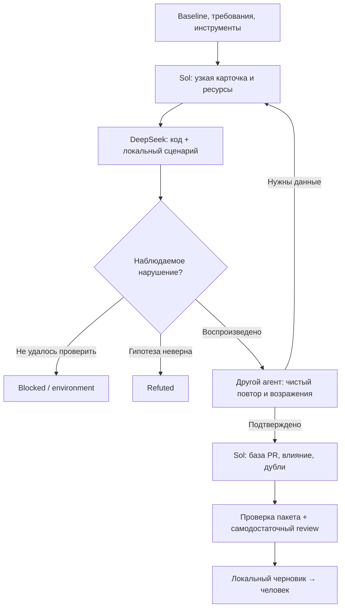

# Пайплайн ревью PR #68 для Sol и DeepSeek

Готовый процесс для запуска координатором в Zed: карточки задач, промпты ролей, форматы результатов, запись запусков, локальная проверка комплектности и сборка черновика review. Скрипт не вызывает API моделей, не управляет интерфейсом Zed и не отправляет GitHub Review. Подключение моделей/браузера выполняется клиентом; end-to-end делегирование DeepSeek пока не проверено.

Почему выбраны такие этапы и что взято из открытых проектов: [исследование](pipeline/RESEARCH.md). Границы работы и требования: [AGENT_TASK.md](AGENT_TASK.md), [протокол координатора](COORDINATION.md). `source/` остаётся неизменным.

Для машины инициатора подготовлены профиль Zed, отдельный Python runtime и проверка DeepSeek tool calling: [текущее состояние настройки](pipeline/LOCAL_SETUP.md). Для тестов приложения используй `scripts/run_review_tests.py`, чтобы работать с отдельной закреплённой копией и Python network guard. Вход ChatGPT и native-делегирование проверяются отдельно.

## Схема



## Быстрый старт

Из корня рабочего репозитория, на ветке `review/<область>`:

```bash
python3 scripts/review_pipeline.py preflight
python3 scripts/review_pipeline.py status
python3 scripts/review_pipeline.py init B01
python3 scripts/review_pipeline.py init C02
python3 scripts/review_pipeline.py init C04
```

Затем передай Sol содержимое [pipeline/prompts/coordinator.md](pipeline/prompts/coordinator.md) и эту инструкцию. До первого настоящего задания координатор проверяет, что native Zed действительно использует DeepSeek для подагентов; `agent.subagent_model` не управляет встроенными подагентами Codex ACP. При работе через Codex ACP используй настроенный внешний CLI-исполнитель; платный доступ и лимиты должны быть уже настроены. Пайплайн не извлекает ключи Zed и не меняет глобальные настройки.

Запрос, который можно вставить координатору:

```text
Прочитай PIPELINE.md и pipeline/prompts/coordinator.md и выполни пайплайн
ревью PR #68. Исходники не менять, ничего не публиковать.
Сначала preflight, B01 и проверка инструментов одного исполнителя;
затем два DeepSeek-исполнителя для C02 и C04 с разными fixtures.
Если интерфейс/провайдер не позволяет выбрать DeepSeek, сообщи причину,
не подменяй модель незаметно и не заявляй, что делегирование выполнено.
Возвращай на перепроверку только пакеты с воспроизведением.
Используй CLI для receipts, check и финального локального bundle.
Все ограничения и непроверенные области включи в REPORT.md.
```

## Этап 0 — допуск к исследованию

Ответственный: Sol. Не занимай агентные слоты простыми вызовами `git`, JSON-проверками и запуском baseline.

- Проверь SHA и чистоту через `preflight`. Сверь официальную фиксацию организатора. Текущее `organizer_freeze_verified=false` допускает исследование выбранного SHA, но блокирует `bundle`. Менять флаг можно только после реальной сверки с указанием первичного источника в REPORT.md; CLI его не меняет.
- Выполни B01: карта diff, требования с первичными источниками, runtime и версии, результаты доступных штатных тестов/build. У каждого основного требования должен быть источник и план проверки; недоступные требования пометь пробелом. Не утверждай полноту на основании восьми жалоб.
- Подтверди соответствие running backend и frontend закреплённому коду. Известный локальный runtime использует соседний checkout, а не `source/`. Один совпадающий SHA backend не доказывает свежесть frontend image.
- Подготовь отдельный dev/test runtime вне `source/`, синтетические fixtures и fake Google/GitHub. Не используй окружение/отчёты sensei-mcp. Не устанавливай dev-зависимости в уже работающий общий контейнер.
- Сделай smoke: один исполнитель читает локальный файл, запускает безвредную команду и сохраняет результат; координатор проверяет фактическую модель в интерфейсе. Для browser-роли отдельно открой локальный сайт, проверь DOM, сеть и screenshot. Не считай конфигурационный флаг vision доказательством работы vision.

B01 — задача покрытия, а не потенциальная находка. Его итог можно положить в `scratch/pipeline/B01/coverage.md` и сводные REQUIREMENTS.md/REPORT.md. Не требуется искусственно доводить B01 до accepted.

## Этап 1 — делегирование

[pipeline/tasks.json](pipeline/tasks.json) содержит 12 стартовых пакетов, включая все жалобы коллеги и дополнительные области задания. Порядок волн — предложенный приоритет, а не строгая зависимость:

| Волна | Пакеты | Порядок работы |
|---|---|---|
| 0 | B01 | Sol устанавливает требования, область и среду |
| 1 | C02, C04 | Два исполнителя: очередь и идентификация |
| 2 | C01, C05, C06, C08 | Запуск/UI, кэш и порядок; связанные мутации сериализовать |
| 3 | C03, C07, S01, D01, T01 | CI, преподаватель, расписание, сохранность и команды |

Старт — два исполнителя плюс Sol. Третий допускается после приёмки первого пакета и только для независимых ресурсов; реальный лимит слотов клиента имеет приоритет. Один пакет — один инвариант и один ответственный. Более широкий пакет дели на новые уникальные ID в tasks.json до запуска, сохраняя происхождение гипотезы. Один пакет может завершиться без находки.

Координатор назначает: actor ID и модель; цель и основание ожидания; fixture/reset; runtime/порт или эксклюзивное время; границы записи; срок. Запиши назначения в `scratch/pipeline/<ID>/assignment.md`. Без изоляции нельзя параллельно менять общую очередь. Все агенты разделяют файловую систему, поэтому общие документы и git-ветку меняет только Sol.

Получить готовый текст задания:

```bash
python3 scripts/review_pipeline.py prompt C02 --role discover
```

Передай вывод подагенту вместе с назначением ресурсов. Скрипт выводит промпт; фактический spawn делает агентный клиент, не Python. Полный диалог, ключи и сырые логи в контекст исполнителя не передавай.

## Этап 2 — поиск и воспроизведение

Исполнитель работает по `pipeline/prompts/discover.md`. Сначала проверяет требование и путь вызова, затем создаёт тест или сценарий. Обычные тесты проекта, Semgrep/Schemathesis/ZAP при использовании дают диагностическую информацию; подтверждение находки требует конкретного нарушения и воздействия.

После `init` JSON-шаблоны лежат в `scratch/pipeline/<ID>/`. Они намеренно имеют статус blocked и пустые поля. Исполнитель заполняет `discovery.json`:

- `status`: `reproduced`, `refuted`, `blocked`, `environment` или `inherited`;
- `actor`, SHA, название, требование (`source`, `basis`), ожидаемое/фактическое, влияние и ограничения;
- `source_locations`: объекты вида `{"file":"source/main.py","line":123}` с реальными строками;
- `pr_relation`: `classification=introduced/inherited/unknown` и конкретное основание сравнения с базой;
- `reproduction`: `kind`, точные инструкции, receipt и относительные пути доказательств.

Тесты и README — в `repro/<ID>/`, очищенные доказательства — в `evidence/<ID>/`. Необработанные stdout/stderr остаются в `scratch/`. Перед добавлением доказательств в Git проверяй их содержимое.

Для терминального прогона оберни **проверенную координатором команду** в recorder. Пример формы команды после создания настоящего теста и окружения:

```bash
python3 scripts/review_pipeline.py run C02 --actor worker-queue-A \
  --timeout 120 --artifact repro/C02/test_unique_registration.py -- \
  env PYTHONPATH=source .venv/bin/python -m pytest -p no:cacheprovider \
  repro/C02/test_unique_registration.py -q
```

Этот тест ещё не существует: пример показывает интерфейс, а не готовое доказательство C02. `--artifact` повторяется для всех существенных файлов воспроизведения, fixtures и конфигов вне source. Recorder хранит их SHA-256, argv, время, exit code, timeout и лог; повторно проверяет baseline. Команда выполняется из корня ревью, без shell-интерполяции. Сам recorder **не песочница**, не ограничивает сеть/стоимость, не запрещает опасные argv и не контролирует файловые записи дочернего процесса. Запускай только локальные согласованные команды; baseline обнаруживает изменение source после факта.

Recorder возвращает exit code целевой команды: `1` от падающего regression ожидаем; `124` означает timeout, а не дефект. Полученный путь `scratch/pipeline/<ID>/runs/<uuid>.json` внеси в `reproduction.receipt`.

Два формата доказательства:

| Формат | Ожидаемый машинный результат | Что оценивает человек/проверяющий |
|---|---|---|
| `regression` | Желаемый контракт, exit 1 на закреплённом коде | Конкретный assertion падает из-за дефекта, не setup/import; существующий success-тест на наличие бага не подходит |
| `scenario` со скриптом | Скрипт наблюдений завершился 0, сохранил факт | Вывод/HTTP/состояние действительно противоречат требованию; код 0 сам по себе не означает корректность приложения |
| `scenario` вручную через браузер | Receipt может отсутствовать | Нужны `manual_observation=true`, `observed_steps`, точные действия и собственные артефакты; это явное свидетельство наблюдателя |

На этапе поиска — 15 минут и две попытки одного подхода. Затем конкретный blocked/ограничение или решение Sol об ином методе. Это организационные пределы; автоматически recorder ограничивает только отдельную команду (максимум 900 секунд). Пакет с новой самостоятельной гипотезой выделяется в новый ID.

## Этап 3 — независимое воспроизведение

Sol передаёт пакет другому исполнителю:

```bash
python3 scripts/review_pipeline.py prompt C02 --role verify
```

Проверяющий выполняет `pipeline/prompts/verify.md` в отдельном чистом fixture/context, под своим actor ID. Использует исходный сценарий, не меняет тест автора, создаёт новый receipt через `run` либо собственные manual-наблюдения. Заполняет `verification.json`: `confirmed/refuted/blocked`, артефакты и проверки требования, причины падения, базы, независимости и сильнейшего возражения.

Sol разрешает противоречие по конкретным данным. Один целевой возврат автору допустим; после повторяющегося тупика — blocked или самостоятельный прогон Sol. Нельзя считать большинство голосов доказательством. Для чисто статического сравнения базы укажи это прямо; если поведение на базе не запускалось, так и напиши.

## Этап 4 — решение и комплектность

Sol читает доказательства, объединяет дубли, назначает приоритет по реальному воздействию. Заполняет `decision.json`:

- `accepted`, `refuted`, `blocked`, `inherited`, `environment` или `duplicate`;
- координатор, конкретное обоснование; для duplicate — ID исходной находки;
- флаги `evidence_reviewed`, `sanitized`, `deduplicated` только после соответствующей проверки.

Для accepted Sol пишет `scratch/pipeline/<ID>/REVIEW.md` по `findings/TEMPLATE.md`: SHA/строки, основание, исходные синтетические данные, минимальный тест **или** шаги, ожидание/факт, существенный вывод и ограничения. Ссылки на приватный репозиторий не заменяют содержимое.

```bash
python3 scripts/review_pipeline.py check C02
```

Check отклоняет пустые поля, несовпадающий SHA, отсутствующие артефакты, одинаковый actor автора/проверяющего, неверные exit codes, timeout, изменившиеся файлы воспроизведения/логи и отсутствие решения Sol. Для manual-сценариев проверяет наличие явных наблюдений. Exit 0 означает комплектность по этим правилам, **не автоматическое доказательство дефекта**.

Actor ID и JSON не защищены от подделки человеком/агентом, имеющим доступ к диску. Хэши обнаруживают изменение после прогона, но не создают защищённую историю. Независимость сессий, верность требований, полнота хэшируемых inputs и очистка доказательств остаются ответственностью координатора. Не давай исполнителю задачу самому принять свою находку.

## Этап 5 — передача человеку

После прохождения check координатор переносит только подтверждённое в `findings/<ID>.md`. Общие CANDIDATES.md/REPORT.md отражают также исключения и непроверенные области. Приведи все 12 пакетов к явному исходу: незапущенный пакет означает пробел покрытия, не отсутствие дефектов. Команда `status` показывает решение координатора, а не автоматически вычисленный прогресс исследователя.

```bash
python3 scripts/review_pipeline.py bundle
```

Bundle требует подтверждённый официальный freeze и повторно проверяет каждый accepted-пакет. Создаёт новый локальный Markdown-черновик в `scratch/pipeline/`, без перезаписи предыдущего. Нет принятых замечаний — нет «успешного пустого review». На текущем REVIEW_SCOPE.json ожидается остановка из-за непроверенного freeze; это не ошибка пайплайна.

Публикация в исходный PR требует отдельного явного поручения. Пайплайн не умеет публиковать, исправлять приложение и менять SHA. Завершение: повторный baseline, проверка diff/секретов, список созданных и оставленных процессов. Контейнеры, которые уже работали до сессии, без необходимости не останавливай.

## Проверка самого пайплайна

```bash
python3 -m unittest discover -s tests -v
```

Тесты используют временный синтетический репозиторий и проверяют gates, receipts, timeout, неизменность inputs, ручные сценарии и блокировку финальной сборки. Они не проверяют toyota-skyline, не подтверждают C02 и не являются материалом для исходного review.
